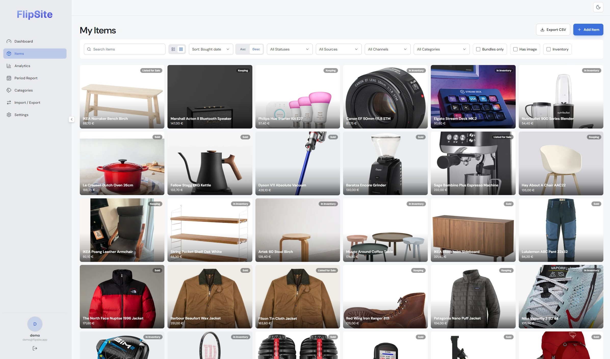
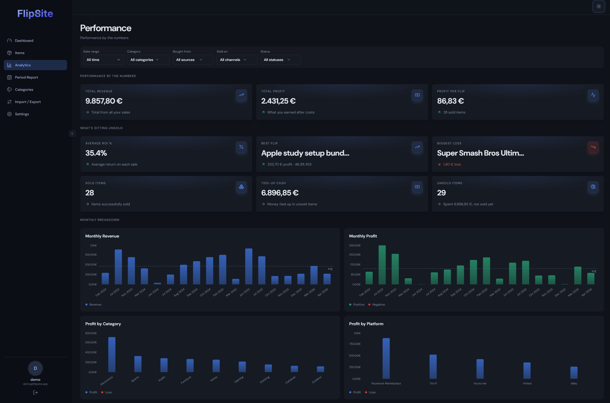
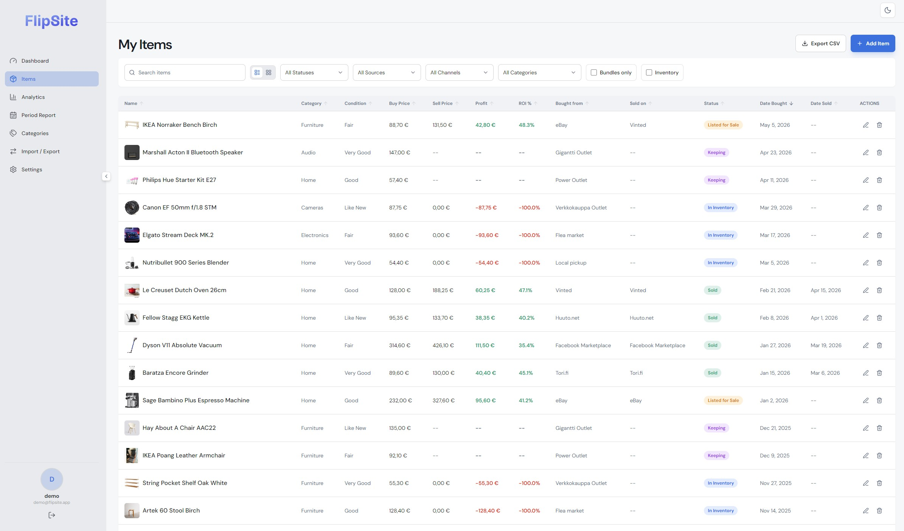

**FlipSite** is a resale inventory tracker I built after my spreadsheet became too annoying to maintain. Adding an item was fine. Keeping photos, receipts, sale status, and split costs connected months later was not.

## The bundle math problem

The main problem was bundles. If I buy a camera kit and sell the body, lens, and accessories separately, each part needs its own status and sale price while sharing the original cost. That is possible in a spreadsheet, until one edit breaks the maths somewhere else.

The rest is straightforward: add photos, prices, platform, and condition; attach receipts; mark items as holding, listed, sold, or keeping; then look at profit, ROI, and how long things have been sitting around.

  
  

## Under the hood

**Supabase** handles auth, Postgres, storage, and row-level security. **TanStack Query** manages server state, while **Recharts** draws the analytics.

  

## Stack

Frontend is **React**, **TypeScript**, **Vite**, and **Tailwind CSS**. The data layer is **Supabase**. I used Radix-style primitives, **lucide-react**, **sonner**, and a little **GSAP** on the landing page.

## Where it stands

It replaced my spreadsheet, so it did its job. If I revisit it, I would move more analytics into the database and sort out import and export sooner. It is deliberately personal, not a marketplace or a reselling SaaS.
