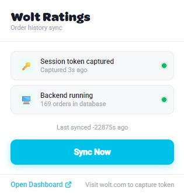
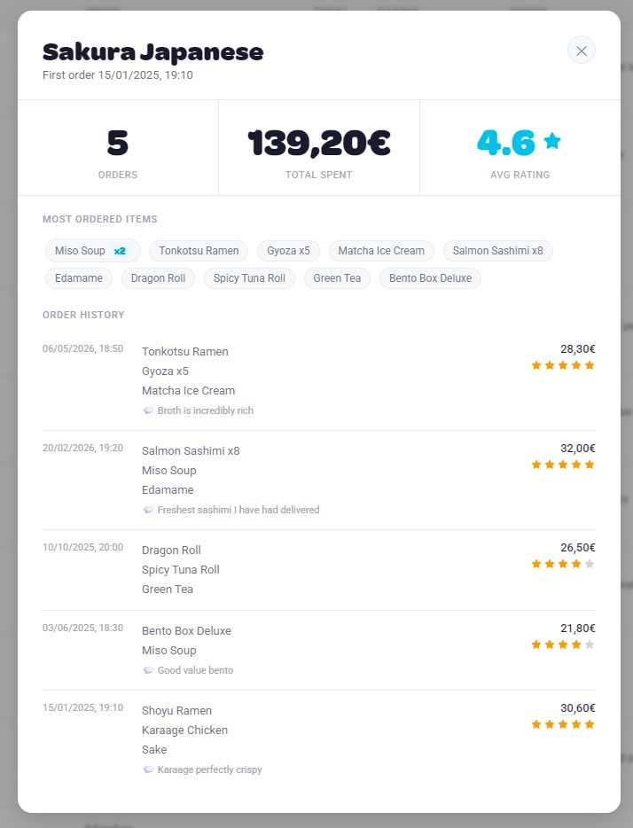

**Wolt Ratings** is a Chrome extension for looking back through Wolt orders and rating them privately. Wolt tells you what you ordered, but not whether it was good, which dish was worth getting again, or how often you made the same lazy dinner choice.

## What it does

- **Venue search and filtering**: Find a place you liked months ago.
- **Private ratings and notes**: Leave an honest note without publishing a review.
- **Spending context**: See delivery habits without sending the data anywhere else.

Order history is stored in browser local storage. No account and no cloud sync.

  
  

## The key decision

It could have been a web app with login, a database, and sync. That would have made it easier to describe, but worse for the job. Food history is personal enough that I did not want to host it. Browser storage is the right boundary here.

## Stack

The extension is **JavaScript** with browser storage. A small **Python** and **Flask** side handles local data work. There is no frontend framework because the interface does not need one.

## Where it stands

It works for reviewing order history and remembering which places are worth repeating. The weak point is Wolt's page structure: if it changes, the scraping breaks. I would make importing and updates more deliberate and add better handling for UI changes.
