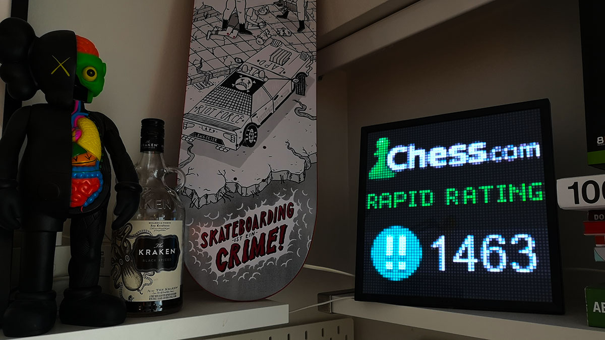

I wanted to see my chess rating without opening Chess.com or checking my phone. A Pixoo display was already sitting on my shelf, so I made it show the number instead.

## How it works

The script does three small things:

1. Fetches stats from Chess.com's public API.
2. Renders the rating as a high-contrast image.
3. Sends that image to the Pixoo over the network.

The endpoint is:

    https://api.chess.com/pub/player/{username}/stats

It returns ratings for blitz, rapid, bullet, and daily chess. The script uses `requests` to get the JSON and pulls out the mode I want.

    import requests

    def fetch_chess_stats(username):
        url = f"https://api.chess.com/pub/player/{username}/stats"
        headers = {"User-Agent": "ChessRatingDisplay"}
        response = requests.get(url, headers=headers)

        if response.status_code == 200:
            return response.json()

        return None

## The display

Pixoo takes small images over the network, which made layout, font, and colour entirely my problem. That is useful at this resolution: the display works best when it has one thing to say.

The script checks the rating periodically and updates the image when it changes. No dashboard, database, or web app needed.

## What I would change

I would add an offline state or a last-updated time. Hardware should tell you when it is stale instead of requiring a terminal check.

_The Pixoo display showing my current Chess.com rating._
