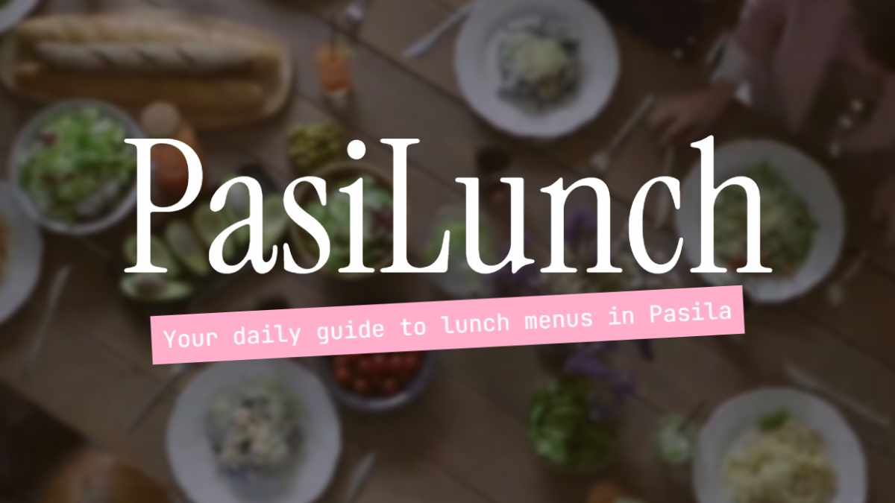

[LunchBot](/posts/2024-03-lunchbot/) was useful, but it only got me so far. Restaurant sites change, menus arrive in strange formats, and the raw text was too inconsistent for a decent web view. PasiLunch is the rebuild.

## What it does

- `/lunch` posts the day's menus in Slack.
- A web dashboard shows the same menus in a browsable format.
- Each restaurant has its own scraper for HTML, JSON, or whatever else it publishes.
- A daily cache avoids repeatedly scraping sites and calling the model.

## Why Gemini is involved

I use normal parsers wherever I can. The problem is that restaurant menus are not a stable data source: Finnish and English get mixed together, prices appear in different places, and useful notes sit beside filler text.

After scraping, Gemini translates and normalises the result into one JSON shape with dish names, prices, notes, and dietary markers. The web dashboard and Slack command both read that same output. It is not magic and it does not make the sources reliable, but it saves me from writing endless source-specific cleanup rules.

## Stack

**Node.js**, **Express**, **Cheerio**, Slack's API, Gemini, JSON cache files, and Render. The dashboard is server-rendered on purpose: it is small, fast, and does not need a frontend app.

## Things that still break

Every restaurant can change its page structure whenever it likes. Free hosting also means the app cannot assume local files will stay around forever, so refreshes are lazy and caches must be safe to recreate.

The main job is preserving details while cleaning the source. Prices, buffet notes, and dietary labels are exactly the things people want to know and exactly the things that are easy to lose.

## Try it

[Open the PasiLunch dashboard](https://lunchbot-btnu.onrender.com/).

_PasiLunch gathers daily menus for restaurants in Pasila._
