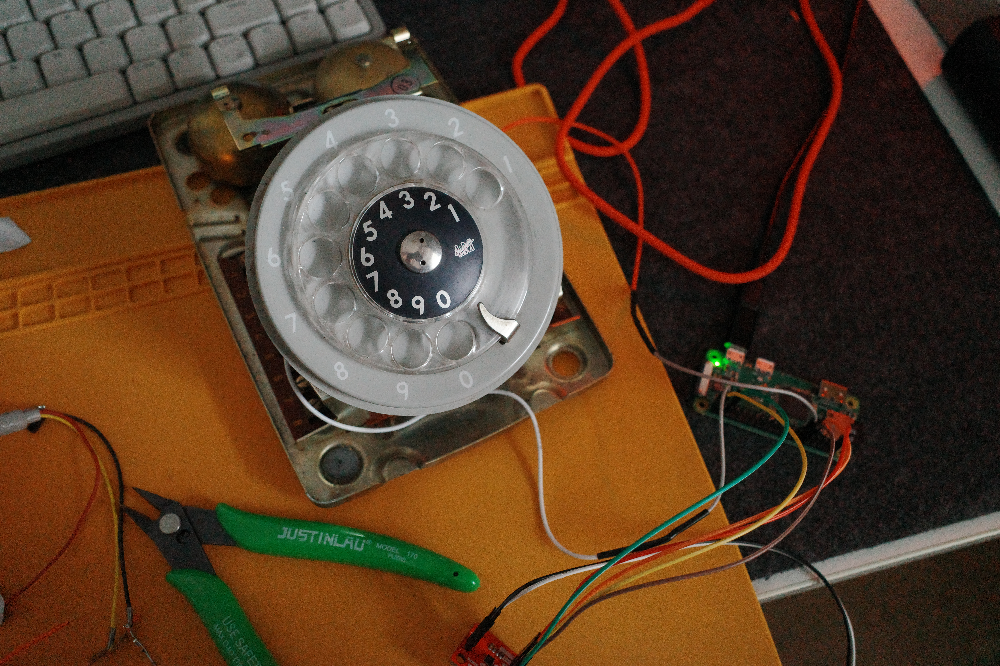
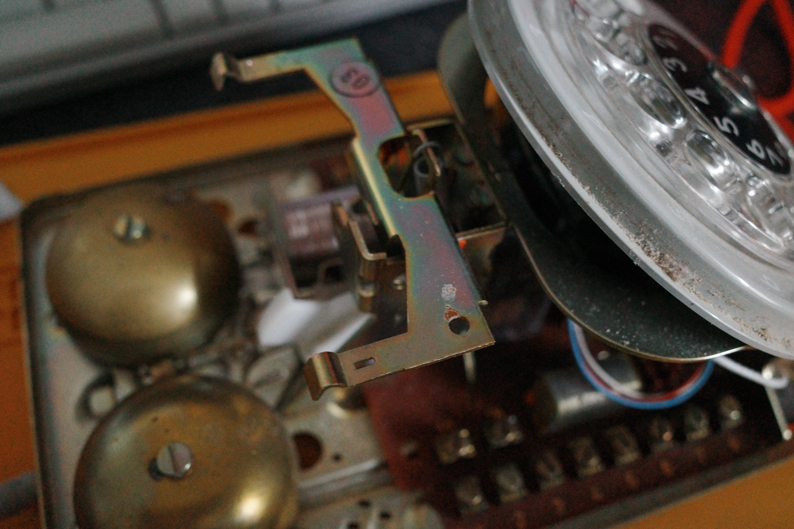
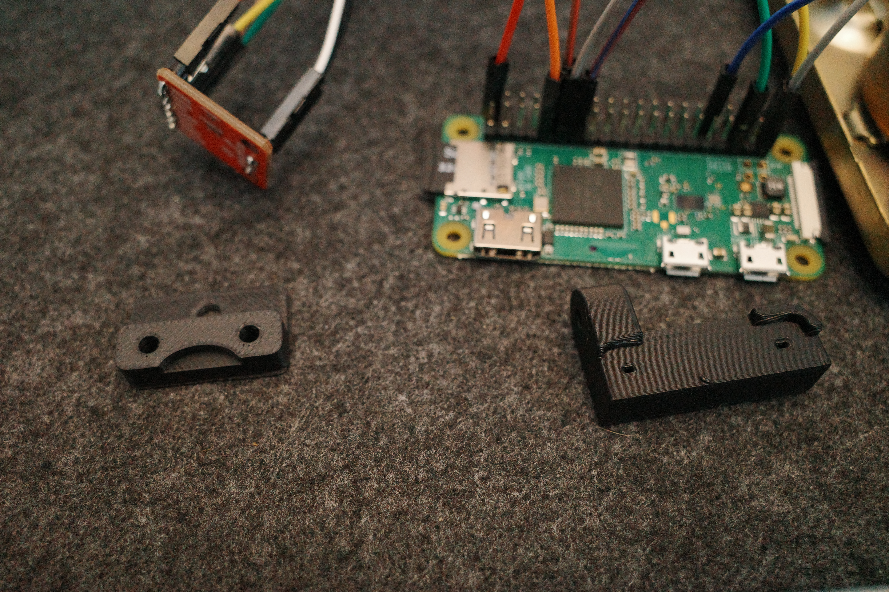
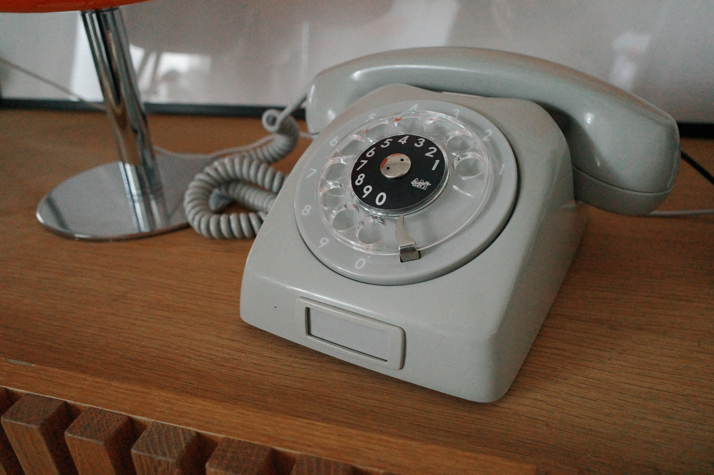

PiPhone is an old rotary telephone turned into a poetry player. Lift the handset and it chooses an audio poem from a public feed and plays it through the original speaker. No screen, no menu, no app.



## Keeping the phone usable

The dial, cradle switch, bells, springs, and terminal strips take up most of the case. I wanted to keep the physical parts that make it feel like a telephone, so the new electronics had to fit around them.

That was more work than the software. A Pi mounted a few millimetres too high is enough to stop the case closing or interfere with the dial.



## Hardware

The host is a headless Raspberry Pi. I made and 3D-printed mounts for the Pi and amplifier instead of drilling random holes in the chassis. They keep the boards away from the metal case, leave connectors accessible, and stop things moving when the phone is picked up.

Audio goes over I2S to a SparkFun MAX98357A mono amplifier. The Pi supplies power, ground, bit clock, left/right clock, and serial data; the amplifier drives the telephone speaker.



## Audio setup

The generic I2S device-tree overlay exposes the audio card through ALSA. These were the useful checks:

```bash
aplay -l
cat /proc/asound/cards
alsamixer -c 0
```

I do not rely on Linux's default audio device. `mpv` is pointed directly at the I2S card:

```text
alsa/sysdefault:CARD=sndrpihifiberry
```

That avoids boot-time surprises when another output is available.

## Getting the poems

The source publishes an XML feed, so there was no reason to automate a browser. The script fetches the feed, picks an item, gets its `<enclosure>` URL, and sends that URL to `mpv`.

```python
import html
import random

import requests
from bs4 import BeautifulSoup


def get_random_audio_url(feed_url: str) -> str:
    response = requests.get(feed_url, timeout=15)
    response.raise_for_status()

    feed = BeautifulSoup(response.content, "lxml-xml")
    items = feed.find_all("item")
    if not items:
        raise RuntimeError("Feed contains no audio items")

    item = random.choice(items)
    enclosure = item.find("enclosure")
    if enclosure is None or not enclosure.get("url"):
        raise RuntimeError("Selected item has no enclosure URL")

    return html.unescape(enclosure["url"])
```

`html.unescape` matters because XML feeds often encode query strings as `&amp;`, while `mpv` needs the real URL.

```python
import subprocess


def play_audio(audio_url: str) -> None:
    subprocess.run(
        [
            "mpv",
            "--no-video",
            "--ao=alsa",
            "--audio-device=alsa/sysdefault:CARD=sndrpihifiberry",
            audio_url,
        ],
        check=True,
    )
```

## Handset control

A GPIO input reads the cradle switch, or a toggle switch while testing. When it becomes active, the script fetches a poem and starts playback. It debounces the mechanical contact and refuses to start another player while one is already running.

The whole object has one interaction: lift handset, hear poem. That was the point.


